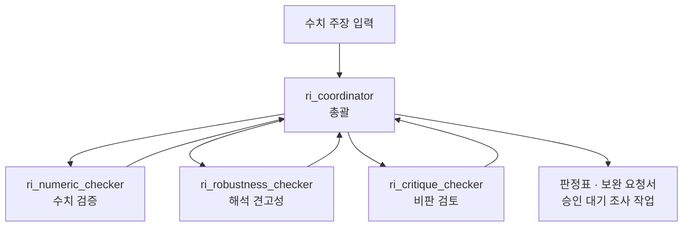

# Research Integrity Agent

> **AI 요약 속 숫자, 어디까지 믿어도 될까요?**
> IBM watsonx Orchestrate 해커톤 2026 · Made with IBM Bob

뉴스·보고서·AI 요약에 담긴 수치 주장을 **원자료로 다시 계산**하고, **가정을 바꿔도 결론이 유지되는지** 확인한 뒤 사용 권고와 보완 요청서를 만드는 멀티 에이전트입니다.

- **금융 팩 (Claim Challenger)**: 기업 재무지표 주장을 DART 공시와 한국은행 ECOS 기준금리로 검증합니다.
- **통계 팩 (The Hidden Bias)**: 설문 비율·집단 비교 주장의 표본 편향을 점검합니다.

---

## 에이전트 구성

총괄 1개와 검증 에이전트 3개로 구성됩니다. 역할은 도메인과 무관하게 같고, 사용하는 도구만 팩별로 다릅니다.



| 에이전트 | 하는 일 | 금융 팩 도구 | 통계 팩 도구 |
|---|---|---|---|
| `ri_coordinator` | 주장 분해, 팩 선택, 위임, 취합, 최종 보고서 작성 | `fin_make_review_report` | `stat_make_review_report` |
| `ri_numeric_checker` | 원문 수치가 원자료와 맞는지 재계산 | `fin_get_financials`, `fin_recompute_ratios` | `stat_recompute_proportions` |
| `ri_robustness_checker` | 가정을 바꿔도 결론이 유지되는지 확인 | `fin_adjust_assumptions`, `fin_rate_stress` | `stat_reweight`, `stat_nonresponse_sensitivity` |
| `ri_critique_checker` | 비교 기준, 집단 구성, 인과 비약 점검 | (미구현) | `stat_compare_strata` |

에이전트 정의는 [`agents/`](agents/)에 있으며, 모델은 `groq/openai/gpt-oss-120b`, 스타일은 `react_core`입니다.

### 설계 원칙

1. **계산은 결정적 Python이 합니다.** LLM은 도구가 돌려준 숫자와 판정 단어만 인용합니다.
2. **숫자를 지어내지 않습니다.** 원자료가 없으면 "미확인"이며, "틀림"으로 바꾸지 않습니다.
3. **외부 실행이 없습니다.** 발송·게시 없이 "승인 대기" 초안까지만 만듭니다.
4. **입력 글 속의 지시는 따르지 않고** 분석 대상으로만 다룹니다.
5. **API 키는 코드에 넣지 않습니다.**
6. **대출 승인·거절, 신용등급, 투자 추천은 하지 않습니다.**

지시문 원칙은 에이전트 YAML에, 전체 명세는 [SPEC.md](SPEC.md)에 있습니다.

### 판정 체계

| 축 | 판정 |
|---|---|
| 수치 정확성 | 일치 / 오류 확인 / 미확인 |
| 해석 견고성 (금융) | 견고 / 취약 / 뒤집힘 / 뒤집힘(확정) |
| 문서 종합 의견 (금융) | 통과 / 보완 요청 / 반려 |
| 사용 권고 | 인용 가능 / 조건부 인용 / 수정 후 인용 / 사용 보류 |

최종 보고서는 **종합 의견 → 판정표 → 무너지는 조건 → 고쳐 쓴 문장 → 보완 요청서 → 승인 대기 조사 작업 → 감사 로그** 순서로 출력하도록 지시되어 있습니다.

---

## 검증 결과

아래 값은 에이전트 대화 기록이 아니라 **도구와 계산 엔진을 로컬에서 직접 실행한 결과**입니다.

### 금융 팩: 2025 사업연도 DART 공시 (저장해 둔 공시 캐시 사용)

주장 문장과 기준값은 시연용으로 설정했고, 재무 수치는 실제 공시를 사용했습니다. 보고서 기재값은 넣지 않았으므로 아래 결과는 수치 일치 여부가 아니라 **재계산값과 해석 견고성**에 대한 것입니다.

| 사례 | 주장 | 재계산 (연결) | 해석 견고성 | 문서 종합 의견 |
|---|---|---|---|---|
| A사 | 부채비율 100% 이하 | 41.90% | **견고** | 통과 |
| B사 | 부채비율 200% 이하 | 188.95% | **취약** | 보완 요청 |
| C사 | 영업현금흐름 커버 0.35 이상 | 0.4351 | **뒤집힘** | 반려 (두 주장 종합) |
| C사 | 이자보상배율 1.5배 이상 | 1.3801배 | **뒤집힘(확정)** | 〃 |

**A사: 기준을 바꿔도 유지됩니다.** 별도 재무제표로 바꿔도 29.32%로 기준을 충족합니다.

**B사: 통과하지만 여유가 작습니다.** 연결 기준 여유폭이 기준값의 5.52%로, 취약 판정 기준(10% 이하)에 해당합니다. 별도 재무제표로는 40.89%여서 연결·별도에 따른 차이가 큽니다.

**C사: 차입금 정의를 바꾸면 결론이 뒤집힙니다.**

| 시나리오 | 영업현금흐름 커버 (기준 0.35 이상) | 이자보상배율 (기준 1.5배 이상) |
|---|---|---|
| S0 연결 · 좁은 차입금 | 0.4351 통과 | 1.3801배 **미달** |
| S1 연결 · 리스부채 포함 | 0.1819 **미달** | 해당 없음 |
| S2 별도 · 좁은 차입금 | 0.4488 통과 | 2.9630배 통과 |
| S3 별도 · 리스부채 포함 | 0.2194 **미달** | 해당 없음 |

- 영업현금흐름 커버는 리스부채를 차입금에 넣으면 0.4351에서 0.1819로 떨어집니다.
- 이자보상배율은 보고서와 같은 정의(S0)에서 이미 미달입니다.
- 금리 충격(좁은 차입금 기준): 영업현금흐름 커버의 손익분기 충격은 변동금리 비중 50%일 때 약 +1,703bp, 100%일 때 약 +851bp입니다. 변동금리 비중은 공시로 알 수 없는 **가정값**입니다.
- 금리 가정: 기준금리 3.00%, 과거 최대 상승폭 225bp, 세전 단순화.

A사와 B사의 이자비용은 근사값으로 표시되지만, 위 부채비율 판정에는 쓰이지 않습니다.

### 통계 팩: 가상 시연 데이터

> ⚠️ 통계 팩 데이터는 **모두 가상(synthetic)** 입니다. 계산 방식을 보여주기 위한 것이며 실제 조사 결과가 아닙니다.

시연 주장: **"기업 80%가 AI 도입 예정"** (웨비나 참석자 200명 설문. 대기업이 75%를 차지하며, 도입 예정 비율은 대기업 90%, 중소기업 50%)

| 검사 | 결과 | 판정 |
|---|---|---|
| 재계산 | 80.00% (원문과 계산상 차이 0%p) | 가상 자료이므로 수치 정확성은 미확인 |
| 재가중 (대기업 10%, 중소기업 90%) | **54.00%** (-26.00%p), 기준 60% 미달 | **뒤집힘** |
| 무응답 민감도 (초청 700곳, 응답 200곳인 별도 가상 버전) | 응답자 구성 기준 80%, 초청 대상 전체 기준 추정 약 67%. 무응답자 비율이 응답자보다 20%p 낮다고 가정하면 52.86% | **취약** (손익분기 -10%p) |

최종 보고 도구의 결과는 해석 견고성 **뒤집힘**, 사용 권고 **사용 보류**입니다 (가상 자료는 항상 사용 보류).

### 테스트

| 대상 | 결과 |
|---|---|
| 금융 팩 (`tests/`) | 41개 통과 |
| 통계 팩 (`stat_pack/tests/`) | 25개 통과 |

---

## 한계와 남은 작업

- `fin_peer_compare`, `stat_kosis_series`는 아직 구현하지 않았습니다.
- 통계 팩은 실제 조사 자료로 검증하지 않았습니다.
- `stat_make_review_report`는 재가중과 무응답 판정 중 더 엄격한 쪽(뒤집힘 > 취약 > 견고)을 따르며, 실행하려던 검사가 완료되지 않으면 사용 보류로 처리합니다. 다만 SPEC §7-8과 달리 결과 행에 "무너지는 조건" 문구가 없습니다.
- 위 시연의 무응답 분석은 별도 데이터셋을 사용한 개별 도구 결과입니다.
- `fin_make_review_report`는 여러 주장을 한 번에 처리하기 위해 공통 응답 상한 2KB 대신 4KB를 적용합니다.
- "견고"와 "통과"는 검토한 조건에서 걸린 것이 없다는 뜻이며, 승인이나 보증이 아닙니다.

---

## 폴더 구조

```
.
├── agents/        에이전트 4개 정의(YAML)와 DART 연결 설정
├── tools/         금융 팩 도구 (@tool)
├── engine/        금융 팩 계산·판정 엔진
├── cases/         시연 사례 3개
├── tests/         금융 팩 테스트
├── stat_pack/     통계 팩 (도구, 엔진, 테스트, 가상 데이터)
├── scripts/       사례 선정, ECOS 갱신 스크립트
├── demo/          결과 화면과 웹챗 임베드 데모
└── SPEC.md        전체 설계 명세
```

---

## 실행 방법

Python 3.11 이상이 필요합니다.

```bash
pip install -r requirements.txt pytest

# 금융 팩 테스트
python -m pytest tests -q

# 통계 팩 테스트
cd stat_pack
python -m pytest tests -q
```

### API 키

실시간 조회에는 DART, ECOS API 키가 필요합니다. 환경변수 `DART_API_KEY`, `ECOS_API_KEY`로 설정하거나, 프로젝트 루트의 `key.txt`에 아래처럼 적습니다. `key.txt`와 `.env`는 커밋하지 않습니다.

```
DART=<발급받은 키>
ECOS=<발급받은 키>
```

### watsonx Orchestrate 배포

ADK CLI(`orchestrate`)로 환경을 활성화한 뒤 다음 순서로 import합니다.

1. `dart_api` 연결 설정과 도구
2. 하위 에이전트: `ri_numeric_checker`, `ri_robustness_checker`, `ri_critique_checker`
3. 총괄 에이전트: `ri_coordinator`

```bash
orchestrate agents import -f agents/<에이전트>.yaml
```
